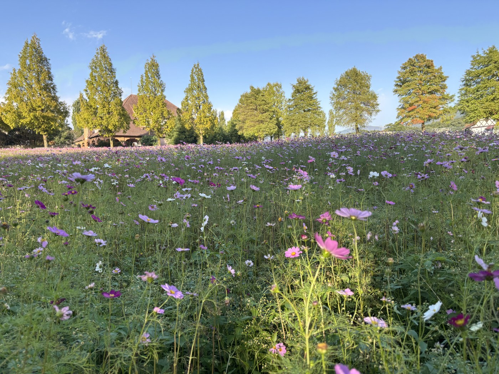
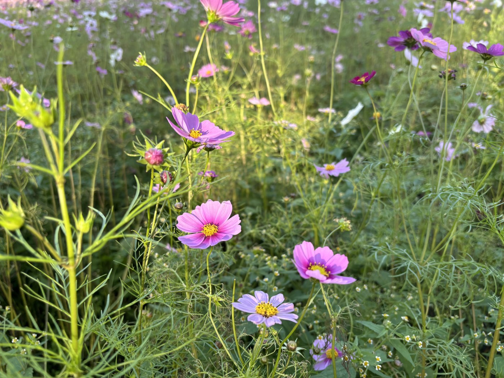
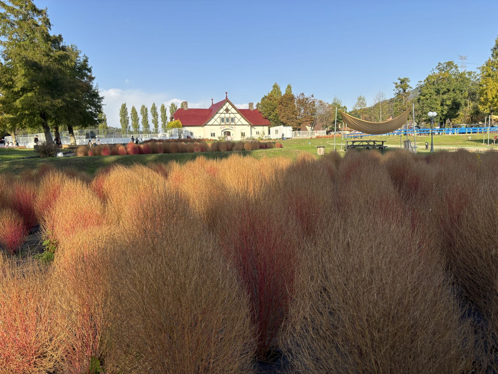
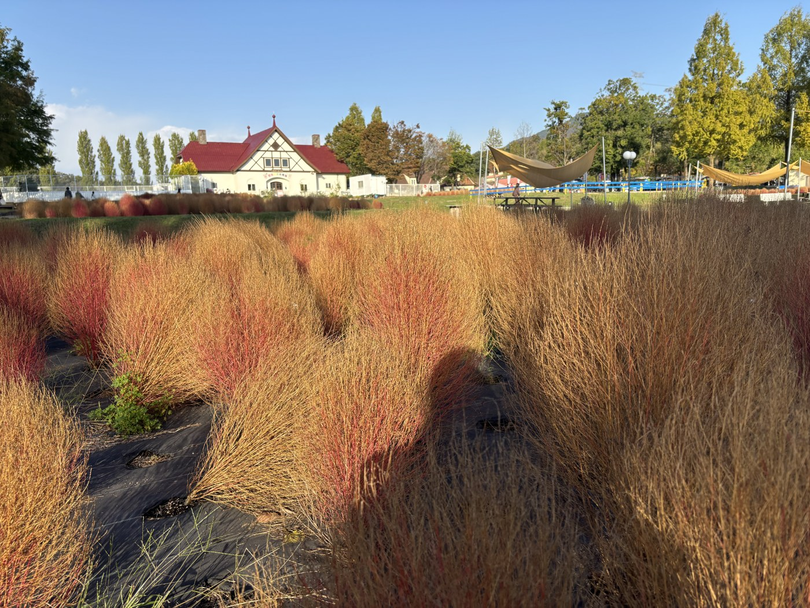

10月31日、滋賀農業公園ブルーメの丘へ行ってきました。日野町西大路にある、ドイツの農村をテーマにした農業公園です。

## コスモスは満開

園内の斜面が一面コスモスでした。濃いピンク、淡い藤色、白が混ざって咲いています。

この日は空がよく晴れていました。

近づくと、咲いている花のとなりにまだ固いつぼみがいくつも付いていました。しばらくは楽しめそうです。

## コキアは赤を過ぎて金色に

コキアは真っ赤な時期を過ぎて、麦わらのような金色になっていました。

「紅葉の見頃は終わり」と言ってしまえばそれまでですが、光が当たると全体が金色に光って、これはこれできれいです。根元のほうにはまだ赤みが残っていました。

## 「ジュラ肉恐竜祭 ハロウィンパーティ！」をやっていました

ちょうど[ジュラ肉恐竜祭 ハロウィンパーティ！](https://www.blumenooka.jp/post-20923/)の開催日でした。10月31日ということもあって、仮装をしている人も見かけました。

**このイベントは11月1日（日）もあります。** ただし荒天のときは中止とのことなので、出かける前に公式の案内を確認してください。

## 混み具合

それほど混んでいませんでした。写真も人を気にせず撮れるくらいです。

## 行く前に

開園日や営業時間、イベントの開催状況は変わります。出かける前に[ブルーメの丘の公式サイト](https://www.blumenooka.jp/)で確認してください。花の咲き具合も日々変わるので、この記事は10月31日時点の様子として読んでいただければと思います。
