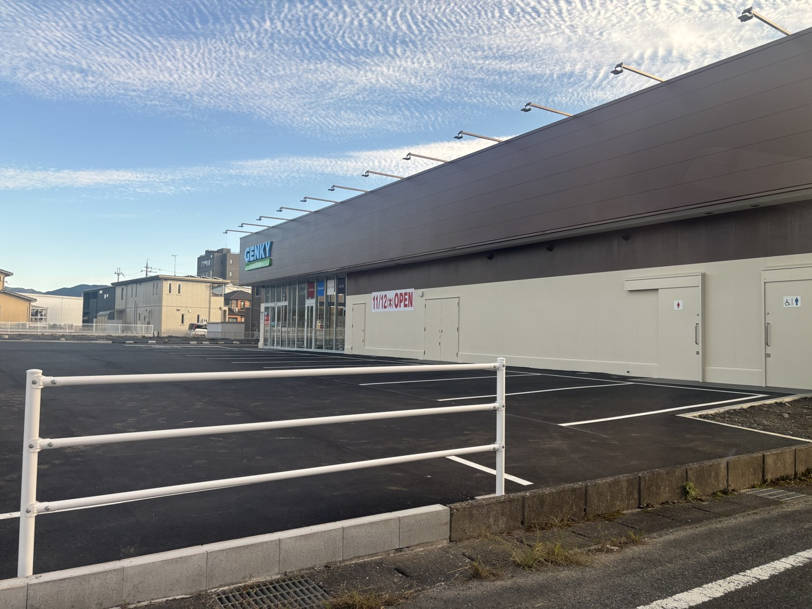

日野町の河原に、ドラッグストアのGENKYが新しくできていました。

**11/12（木）OPEN予定**です。

## 場所

門坂歯科医院と、ファミリーマート日野町河原店の近くです。

道路沿いにはもう看板が立っていて、建物も駐車場も仕上がっていました。白線が引かれ、照明も設置済みで、あとは開けるだけという状態に見えます。

## 町内では2店舗目

日野町のGENKYは内池店に続いて2店舗目になります。

看板にある「FOOD & DRUG」のとおり、GENKYは医薬品や化粧品、日用品に加えて食品も扱うドラッグストアです。運営は福井県坂井市の[ゲンキー株式会社](https://genky.co.jp/)で、「近所で生活費が節約できるお店」を掲げ、生鮮食品の取り扱いにも力を入れています。愛知・岐阜・福井・石川・滋賀の5県に出店していて、2026年6月の時点で滋賀県内には40店舗ありました（有価証券報告書による）。
